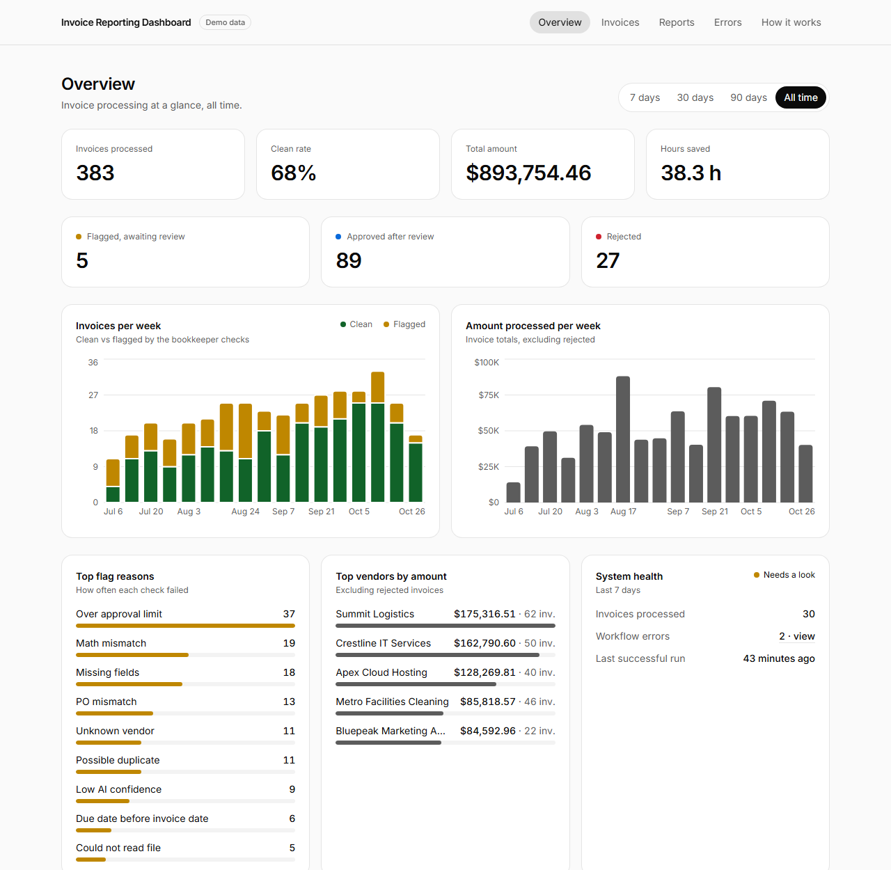
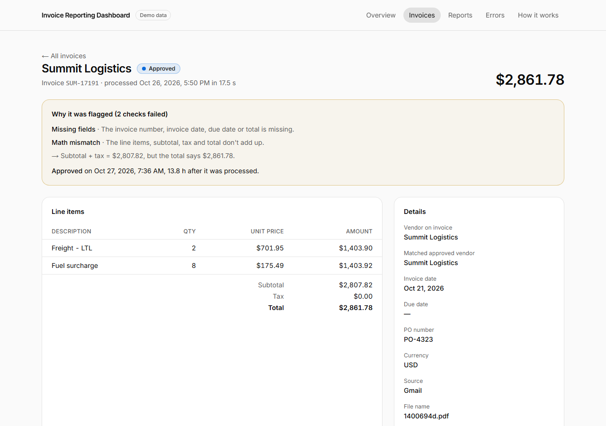
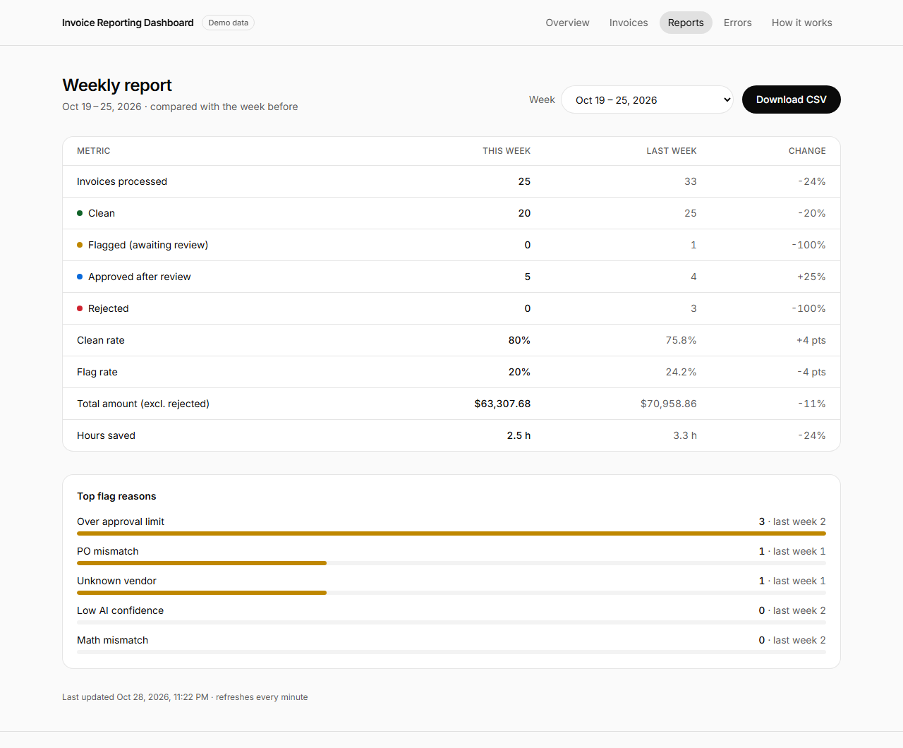
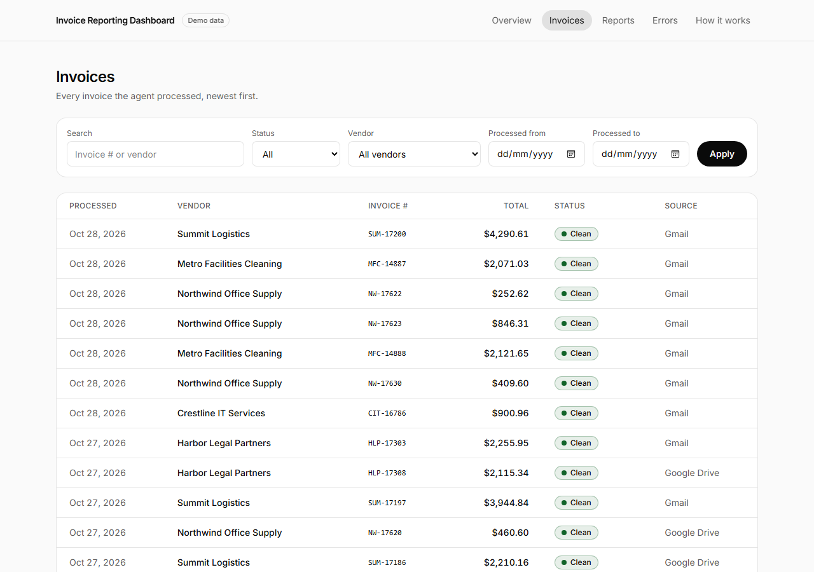
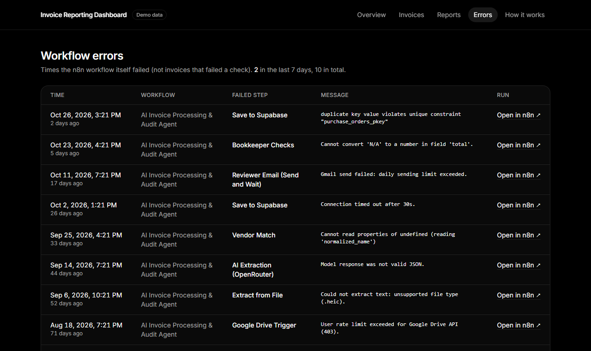
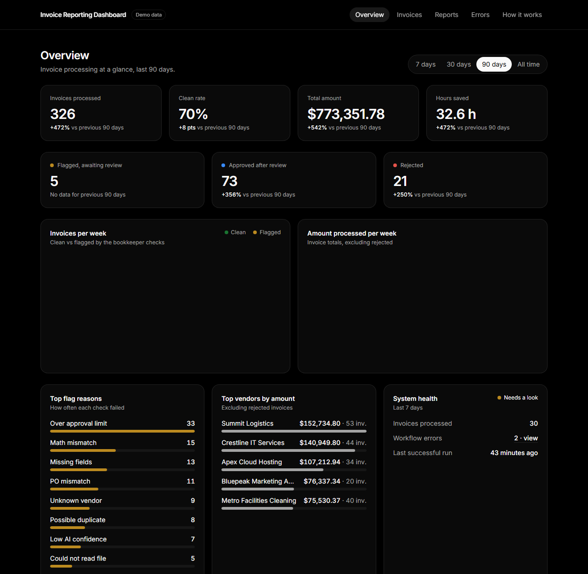
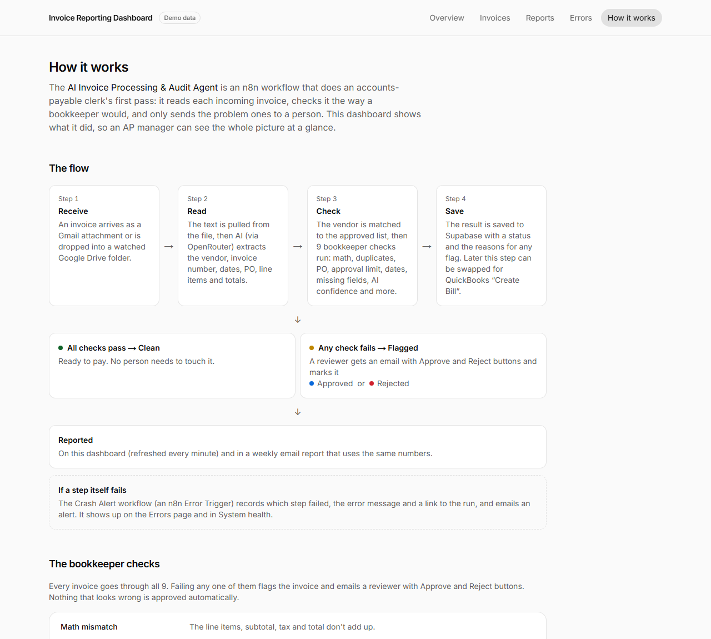
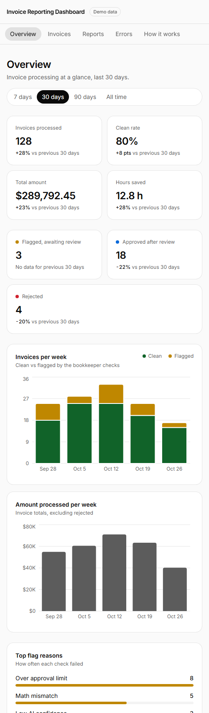

# Invoice Reporting Dashboard

**Live reporting for an AI invoice agent.** An AP manager opens one page and sees what the agent did: how many invoices came in, how many passed every bookkeeper check, what got flagged and why, how much money went through, and how many hours of manual work it saved.

Part 2 of my automation portfolio → [lovergil-perillo-portfolio.vercel.app](https://lovergil-perillo-portfolio.vercel.app)



## The problem it solves

Accounts-payable teams key invoices in by hand: open the PDF, type the numbers, check the math, look up the vendor and the PO, and chase anything odd. My **AI Invoice Processing & Audit Agent** (an n8n workflow) does that first pass automatically and only sends the problem invoices to a person.

But automation nobody can see is automation nobody trusts. This dashboard answers the questions an AP manager actually asks:

- *Is it working?* Invoices processed, clean rate, and system health (runs, errors, last successful run).
- *What needs my attention?* Flagged invoices waiting for review, and the reasons, in plain English.
- *Is it worth it?* Total amount processed and hours saved, calculated openly.
- *What do I send my boss?* A weekly report with a one-click CSV download.

## What it shows

| Page | What you see |
|---|---|
| **Overview** | 7 number cards with change vs the previous period, invoices per week (clean vs flagged), amount per week, top flag reasons, top vendors, system health. Range: 7 / 30 / 90 days / all time. |
| **Invoices** | Searchable, filterable table (status, vendor, date range), paginated. Turns into cards on phones. |
| **Invoice detail** | Every extracted field and line item, *why* it was flagged (including the actual math that doesn't add up), who approved or rejected it and how fast, AI confidence per field, link to the original file. |
| **Reports** | Weekly summary vs the week before (same numbers as the n8n weekly email), week picker, **Download CSV**. |
| **Errors** | Every time the workflow itself failed: time, failed step, message, link to the n8n run. |
| **How it works** | The agent's flow, the 9 bookkeeper checks, error handling, and exactly how "hours saved" is calculated. |

| | |
|---|---|
|  |  |
|  |  |
|  |  |



## How it connects to the n8n invoice agent

```
Gmail / Google Drive ──► n8n: AI Invoice Processing & Audit Agent ──► Supabase ──► this dashboard (read-only)
                          extract (OpenRouter) → vendor match →          ▲
                          9 bookkeeper checks → save → reviewer email    │
                          (Approve / Reject)                             │
                         n8n: Crash Alert (Error Trigger) ───────────────┘  error_log + email alert
                         n8n: Weekly Report ◄── same SQL rules as the Reports page
```

- The agent writes one row per invoice to `invoices`, one row per run to `run_log`, and failures to `error_log`. The exact columns and rules are in the [data contract](#data-contract-what-the-n8n-workflow-must-write) below.
- Flagged invoices go to a reviewer by Gmail "Send and Wait" with Approve / Reject buttons; the answer updates `status` and `reviewed_at`, and the dashboard picks it up within a minute.
- The save step can later be swapped for QuickBooks "Create Bill" without changing the dashboard.

## Tech

- **Next.js 15** (App Router, server components) + **TypeScript**
- **Tailwind CSS 4**, light and dark mode (follows the device)
- **Supabase** (Postgres) as the data source, read on the server only
- **Recharts** for the two time charts; everything else is plain HTML
- Ready to deploy on **Vercel** (env vars and settings in the Security section)

Four runtime dependencies in total. Design matches my portfolio (Inter, black/white/gray); color is used only for invoice statuses, and the status colors were checked for color-blind readers.

### Security

- **Read-only, server-side.** Pages fetch data on the server (`import "server-only"` guards it); no key or Supabase address reaches the browser, and there are no buttons that change data.
- **Least-privilege key.** The live site uses Supabase's *publishable* key. Row-level security lets it read **demo rows only** of `invoices`, `run_log` and `error_log`, and nothing else in the project (`supabase/security-hardening.sql`). Writes are blocked (tested).
- **Demo data only in public.** `DATA_SCOPE` defaults to `demo`. Real invoices (`all` / `real`) need the secret key and only work on your own computer; the app refuses them on Vercel.
- **No private links in public.** Links to n8n runs and original Gmail/Drive files only show with `SHOW_PRIVATE_LINKS=true` (local).
- **Hardened responses.** Content-Security-Policy, `frame-ancestors 'none'` / `X-Frame-Options: DENY`, `nosniff`, strict Referrer-Policy, Permissions-Policy; no `X-Powered-By`, no public source maps; friendly error pages without database details.
- **Bounded inputs.** Search is length-limited and stripped of filter syntax, filters are validated, the CSV is a two-week summary, and one page load reads at most 20,000 rows.

## Run it locally

```bash
npm install
cp .env.example .env.local   # fill in SUPABASE_URL, SUPABASE_PUBLISHABLE_KEY (and SUPABASE_SECRET_KEY only to seed)
npm run seed                 # optional: 16 weeks of demo data, rows marked is_demo = true
npm run dev                  # http://localhost:3000
```

Database setup (Supabase → SQL Editor):
- Invoice tables **already exist** (created for the n8n workflow): run `supabase/add-dashboard-access.sql`.
- **Brand-new** project: run `supabase/schema.sql`.
- Then, always: run `supabase/security-hardening.sql` (RLS on every table, demo-only reads for the website key).

Local settings in `.env.local` (see `.env.example`): `DATA_SCOPE=all` shows n8n's real invoices on your computer (uses the secret key, refused on Vercel); `SHOW_PRIVATE_LINKS=true` shows n8n run and Gmail/Drive links. Leave both unset on Vercel.

Other commands: `npm test` (report math, weeks, CSV), `npm run typecheck`, `npm run build`.

Remove the demo data once real invoices arrive (keeps real rows):

```sql
delete from run_log where is_demo; delete from error_log where is_demo;
delete from invoices where is_demo; delete from purchase_orders where is_demo;
delete from vendors where is_demo;
```

### Project layout

```
app/              one folder per page (+ loading / error / not-found states)
components/       UI pieces: StatCard, Charts, BarList, StatusBadge, FlowDiagram, ...
lib/config.ts     settings: minutes per invoice, approval limit, time zone, flag codes
lib/format.ts     all money / % / date formatting
lib/report.ts     the report math (shared by Overview, Reports and the CSV) + tests
lib/queries/      every Supabase read
scripts/seed.ts   demo data generator
supabase/         SQL: tables, read-only access, security hardening
```

## Data contract (what the n8n workflow must write)

The dashboard only reads. The n8n workflow writes these rows using the secret / service_role key or the postgres user. Send numbers as JSON numbers, not strings. Leave out `id`, `created_at` and `is_demo`: the database fills them, and `is_demo` must stay `false` for real data.

### `invoices`: one row per invoice file, including files that could not be read

| Column | Type | Required | Allowed values / rule |
|---|---|---|---|
| `vendor` | text | yes* | Vendor name as printed on the invoice. *`null` only when the file could not be read. |
| `vendor_matched` | text | no | `vendors.name` of the matching approved vendor, else `null`. |
| `invoice_number` | text | no | As printed. `null` if missing (then flag `missing_fields`). |
| `invoice_date` | date | no | `"YYYY-MM-DD"` |
| `due_date` | date | no | `"YYYY-MM-DD"` |
| `currency` | text | yes | ISO code, uppercase: `"USD"`. The dashboard's totals assume one currency (USD). |
| `po_number` | text | no | e.g. `"PO-4123"`, or `null` |
| `line_items` | jsonb | yes | List of `{ "description": text, "quantity": number, "unit_price": number, "amount": number }`. `[]` if none. |
| `subtotal` | numeric | no | 2 decimals |
| `tax` | numeric | no | 2 decimals, `0` if no tax |
| `total` | numeric | no | 2 decimals. `null` only if it could not be read. |
| `confidence` | jsonb | yes* | Extraction confidence per main field, 0–1: `{ "vendor": 0.97, "invoice_number": 0.95, "invoice_date": 0.93, "total": 0.99 }`. *`null` only for unreadable files. Used by `low_confidence`. |
| `status` | text | yes | `clean` (no flags), `flagged` (1+ flags, waiting for a person), `approved`, `rejected` (set by the reviewer later) |
| `flag_reasons` | jsonb | yes | List of codes, `[]` when clean. Codes: `math_mismatch`, `duplicate`, `unknown_vendor`, `po_mismatch`, `over_approval_limit`, `missing_fields`, `unreadable_file`, `due_date_before_invoice_date`, `low_confidence` |
| `fingerprint` | text | no | `normalized vendor` + `\|` + `invoice_number` + `\|` + `total` with 2 decimals. Normalized = lowercase, keep only a–z, 0–9 and spaces, remove the words llc/inc/co/corp/ltd, collapse spaces. Example: `"northwind office supply\|NW-10234\|482.50"`. `null` if vendor, number or total is missing. |
| `source` | text | yes | `gmail` or `drive` |
| `file_name` | text | no | Original file name |
| `file_id` | text | no | Google Drive file ID |
| `file_link` | text | no | URL that opens the original file |
| `gmail_message_id` | text | no | When `source = 'gmail'` |
| `reviewed_at` | timestamptz | no | ISO time when a person set `approved` / `rejected`, else `null` |

Rules the checks must follow:
- `clean` only when `flag_reasons` is `[]`. Any flag means `flagged`.
- `math_mismatch`: the line amounts don't add up to the subtotal, or subtotal + tax ≠ total (allow 0.01 rounding).
- `over_approval_limit`: `total` > **5000** (`APPROVAL_LIMIT` in `lib/config.ts`).
- `duplicate`: another invoice already has the same `fingerprint`.
- `unknown_vendor`: no `vendors` row with the same `normalized_name` and `approved = true`.
- `po_mismatch`: `po_number` not found in `purchase_orders`, or its `amount` differs from `total`.
- `missing_fields`: `invoice_number`, `invoice_date`, `due_date` or `total` is missing.
- `due_date_before_invoice_date`: both dates were read and `due_date` < `invoice_date`.
- `low_confidence`: any of `vendor`, `invoice_number`, `invoice_date`, `total` has a confidence below **0.8** (suggested threshold, set it in the workflow).
- `unreadable_file`: the AI could not extract the invoice. Still save a row: `status: "flagged"`, `flag_reasons: ["unreadable_file"]`, extracted fields `null`, `line_items: []`.

Example row:

```json
{
  "vendor": "Northwind Office Supply",
  "vendor_matched": "Northwind Office Supply",
  "invoice_number": "NW-10234",
  "invoice_date": "2026-10-20",
  "due_date": "2026-11-19",
  "currency": "USD",
  "po_number": "PO-4123",
  "line_items": [
    { "description": "Toner cartridge", "quantity": 4, "unit_price": 89.5, "amount": 358.0 },
    { "description": "Printer paper (case)", "quantity": 2, "unit_price": 57.5, "amount": 115.0 }
  ],
  "subtotal": 473.0,
  "tax": 39.02,
  "total": 547.02,
  "confidence": { "vendor": 0.97, "invoice_number": 0.95, "invoice_date": 0.93, "total": 0.99 },
  "status": "flagged",
  "flag_reasons": ["math_mismatch"],
  "fingerprint": "northwind office supply|NW-10234|547.02",
  "source": "gmail",
  "file_name": "NW-10234.pdf",
  "file_id": null,
  "file_link": "https://mail.google.com/mail/u/0/#inbox/18f2c3a9d4e5b6c7",
  "gmail_message_id": "18f2c3a9d4e5b6c7",
  "reviewed_at": null
}
```
(473.00 + 39.02 = 512.02, not 547.02, so it is flagged `math_mismatch`.)

### `run_log`: one row each time the workflow finishes processing an invoice

| Column | Type | Rule |
|---|---|---|
| `invoice_id` | uuid | `invoices.id` of the row just saved |
| `processing_ms` | integer | Time from receiving the file to saving the row |
| `minutes_saved` | numeric | `6` (`MINUTES_PER_INVOICE` in `lib/config.ts`) |

`{ "invoice_id": "5b1d…", "processing_ms": 8420, "minutes_saved": 6 }`

### `error_log`: one row per failed execution (written by the "Crash Alert" Error Trigger workflow, which also emails an alert)

| Column | Type | Rule |
|---|---|---|
| `workflow` | text | Workflow name, e.g. `"AI Invoice Processing & Audit Agent"` |
| `node` | text | Name of the node that failed |
| `message` | text | The error message |
| `run_link` | text | URL of the failed n8n execution: `{{ $json.execution.url }}` from the Error Trigger |

`{ "workflow": "AI Invoice Processing & Audit Agent", "node": "AI Extraction (OpenRouter)", "message": "Model response was not valid JSON", "run_link": "https://your-n8n/workflow/abc/executions/1824" }`

### `vendors` and `purchase_orders` (reference lists the checks read)

- `vendors`: `name` (text), `normalized_name` (text, unique, same normalizing as the fingerprint), `approved` (boolean).
- `purchase_orders`: `po_number` (text), `vendor` (text), `amount` (numeric, 2 decimals), `currency` (text, `"USD"`).

## Report definitions

The dashboard and the n8n weekly email must use these exact rules. Settings live in `lib/config.ts` (currently **6 minutes per invoice**, time zone **Asia/Manila**).

| Number | Rule |
|---|---|
| Week | Monday 00:00 to Sunday 23:59, Asia/Manila. An invoice belongs to the week of `created_at` (when the agent processed it), not `invoice_date`. |
| Invoices processed | Count of all invoice rows in the period, any status, including unreadable files. |
| Clean | `status = 'clean'`: passed every check. |
| Flagged (awaiting review) | `status = 'flagged'`: failed a check, still waiting for a person. |
| Approved after review | `status = 'approved'` |
| Rejected | `status = 'rejected'` |
| Clean rate | clean ÷ processed |
| Flag rate | (flagged + approved + rejected) ÷ processed. Does not change after reviews. |
| Total amount | Sum of `total` where `status <> 'rejected'`. Missing totals count as 0. USD. |
| Hours saved | processed × 6 ÷ 60 |
| Top flag reasons | Count of each code in the `flag_reasons` JSON list. An invoice with two reasons counts once for each. |
| Change vs last week | (this − last) ÷ last, whole percent; "—" when last week is 0. Rates: difference in percentage points ("+3 pts"). |

Statuses change after review, so re-running an old week can move invoices from Flagged to Approved/Rejected. Processed, flag rate and hours saved stay the same.

### Same numbers in SQL (for the n8n weekly email)

Replace `2026-10-19` with the Monday of the week.

```sql
-- Summary
select
  count(*)                                                                   as processed,
  count(*) filter (where status = 'clean')                                   as clean,
  count(*) filter (where status = 'flagged')                                 as flagged,
  count(*) filter (where status = 'approved')                                as approved,
  count(*) filter (where status = 'rejected')                                as rejected,
  round(100.0 * count(*) filter (where status = 'clean')  / nullif(count(*), 0), 1) as clean_rate_pct,
  round(100.0 * count(*) filter (where status <> 'clean') / nullif(count(*), 0), 1) as flag_rate_pct,
  coalesce(sum(total) filter (where status <> 'rejected'), 0)                as total_amount,
  round(count(*) * 6 / 60.0, 1)                                              as hours_saved
from invoices
where created_at >= ('2026-10-19'::date)::timestamp at time zone 'Asia/Manila'
  and created_at <  ('2026-10-19'::date + 7)::timestamp at time zone 'Asia/Manila';

-- Top flag reasons
select reason, count(*) as invoices
from invoices, jsonb_array_elements_text(coalesce(flag_reasons, '[]')) as reason
where created_at >= ('2026-10-19'::date)::timestamp at time zone 'Asia/Manila'
  and created_at <  ('2026-10-19'::date + 7)::timestamp at time zone 'Asia/Manila'
group by reason
order by invoices desc;
```

The site rounds rates to 1 decimal (same as the SQL) and changes to whole percents.

### Connect n8n to Supabase (Postgres credential)

Use the **Session pooler**. The "Direct connection" address only works over IPv6, which Docker Desktop on Windows usually doesn't have. The Session pooler works over normal IPv4.

1. **Get the connection details.** In Supabase, open your project and click **Connect** (top of the page). Open the **Session pooler** tab and note:
   - Host: `aws-0-<region>.pooler.supabase.com`
   - Port: `5432`
   - Database: `postgres`
   - User: `postgres.<project-ref>`. The dot and project ref are part of the user name.
2. **Get the password.** It's your **database password**, not an API key. If you've forgotten it, go to Project Settings → Database → **Reset database password**. Resetting it also breaks anything else that uses it, such as your RAG workflow's Postgres credential, so update those too.
3. **Create the credential.** In n8n, go to **Credentials → Create credential → Postgres** and fill in:
   - Host, Database, User, Password and Port from steps 1 and 2.
   - **SSL:** `Require`. If the connection test fails with a certificate error, also turn on **Ignore SSL Issues**.
4. Click **Save**. n8n tests the connection, and you should see "Connection tested successfully".
5. **Use it.** In the weekly email workflow, add a **Postgres** node, choose **Execute Query**, and paste a query from above. Each row comes out as one n8n item.

Don't use the **Transaction pooler** (port `6543`). It doesn't support the prepared statements the n8n Postgres node uses.

**Optional: give n8n its own read-only user.** The `postgres` user can change or delete anything in the project, including your RAG tables. A read-only login for the weekly email is safer. Run this in the SQL Editor, choosing your own password:

```sql
create role n8n_reports with login password 'choose-a-long-password';
grant usage on schema public to n8n_reports;
grant select on invoices, run_log, error_log to n8n_reports;
-- Row Level Security is on, so the role also needs permission to see the rows:
create policy "reports can read" on invoices  for select to n8n_reports using (true);
create policy "reports can read" on run_log   for select to n8n_reports using (true);
create policy "reports can read" on error_log for select to n8n_reports using (true);
```

Then use User `n8n_reports.<project-ref>` with that password in the credential. Keep using the `postgres` user, or the secret key, for the invoice workflow itself, because it needs to write.
